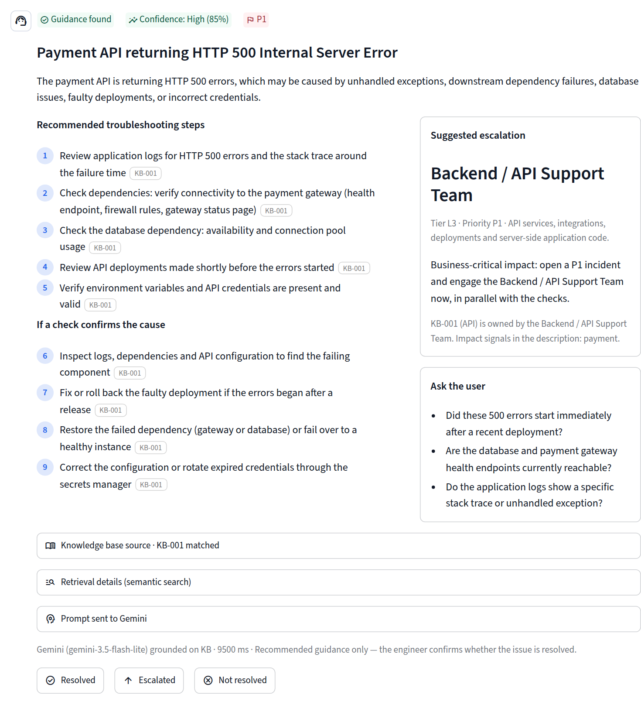
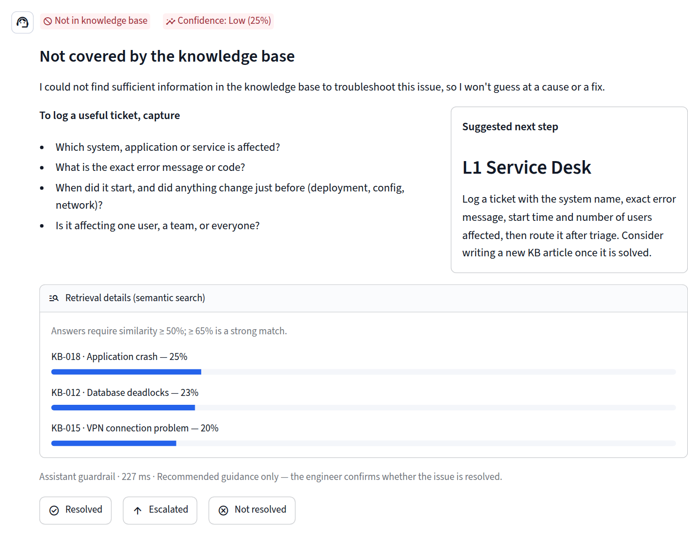

# AI Troubleshooting Assistant for L1/L2 Support

*Practical AI Assignment 3 – Technology Operations Intern*

An AI assistant that helps support engineers investigate common technical issues. It finds the relevant
guidance in a small knowledge base, suggests step-by-step checks and the likely escalation team, shows the
knowledge-base entry it used, and says so when the knowledge base doesn't cover a problem, instead of inventing a fix.

> **Example:** *"The payment API is returning a 500 error."* → matches **KB-001**. The assistant suggests reviewing
> application logs, checking dependencies (payment gateway, database), recent deployments and configuration,
> recommends the **Backend / API Support Team**, and shows KB-001 as the source.

| Grounded answer with source and escalation | Unknown issue: no guess |
|---|---|
|  |  |

**Demo video (90 s):** [`docs/demo.mp4`](docs/demo.mp4), showing the brief's example, an unknown issue, a vague question
with its follow-up, the dashboard and the How it works page. More screenshots in [`docs/screenshots/`](docs/screenshots/).

## Setup

Requires Python 3.10+.

```bash
python3 -m venv .venv && source .venv/bin/activate
pip install torch --index-url https://download.pytorch.org/whl/cpu   # optional: small CPU-only build
pip install -r requirements.txt
cp .env.example .env          # add your Gemini API key to GEMINI_API_KEY
streamlit run app.py          # open http://localhost:8501
```

The first run downloads the embedding model (~90 MB). **Without an API key the app still works**: it answers
straight from the matched knowledge-base entry (KB-only mode), which is also the fallback if Gemini is down.

## Approach

The assistant uses **Retrieval-Augmented Generation (RAG)**:

```
question → guardrails → semantic retrieval → confidence check → Gemini (grounded) → validation → report
              │                                    │ below threshold
              │ secrets redacted,                  └→ "knowledge base has insufficient information"
              └ vague question → ask for details
```

1. **Knowledge base:** 20 sample issues in `knowledge_base/technical_issues.json`, across Server, API, Database,
   Network and Application. Each has symptoms, possible causes, diagnostic checks, a known resolution and an escalation team.
2. **Retrieval:** every entry is embedded as several short texts (its title, each symptom, its keywords) and stored in
   a FAISS index. A question is matched by meaning, not exact words, and each entry keeps its best similarity score.
3. **Confidence check:** if the best match is below **0.50** cosine similarity, the assistant refuses and lists what to
   capture for a ticket. Vague questions ("it's not working") get clarifying questions, and the follow-up is combined with them.
4. **Grounded generation (prompt engineering):** Gemini receives *only* the retrieved entries, plus rules:
   - no outside knowledge;
   - cite a KB ID for every step;
   - present checks as recommendations, not confirmed fixes;
   - never ask for secrets;
   - say `sufficient_context: false` if the entries don't cover the problem.

   The answer comes back as JSON (enforced by a schema).
5. **Validation:** steps citing a KB ID that wasn't retrieved are discarded. If Gemini says the context is
   insufficient, the answer becomes "unknown".
6. **Escalation:** the team comes from the KB entry, not the LLM. Priority (P1/P2/P3) comes from impact words such as
   "production", "all users" or "several users".
7. **Report:** likely issue, ordered checks, fixes to apply if a check confirms the cause, escalation, confidence score,
   and the full source entry. The prompt sent to Gemini can be opened under every answer.

The engineer, not the AI, marks an issue resolved / escalated / not resolved. The dashboard counts these.

## AI tools and models used

| Purpose | Tool / model |
|---|---|
| Embeddings for semantic search | `sentence-transformers/all-MiniLM-L6-v2` (local, CPU) |
| Vector search | FAISS `IndexFlatIP` (cosine similarity) |
| Answer generation | Google Gemini via `google-genai`: `gemini-3.5-flash-lite`, falling back to `gemini-3.1-flash-lite` then `gemini-3.6-flash` if a model is overloaded |
| User interface | Streamlit |

### Where AI tools were used to build this project
- **ChatGPT:** used to break down the assignment and plan the architecture and features.
- **Claude Code (AI coding assistant):** used to generate the code, the sample knowledge base, tests and this README,
  and to calibrate the confidence thresholds.
- **My contribution:** *[fill in, e.g. which requirements and design decisions you made, what you reviewed, changed,
  tested by hand, and what you would do differently]*

## Assumptions

- Users are L1/L2 support engineers describing issues in English.
- The knowledge base is curated and correct. The assistant is only as good as its entries.
- Sample/simulated data only. No access to production systems, logs or ticketing tools.
- Guidance is advisory. The engineer decides whether the issue is resolved.

## Testing

```bash
pytest -q                # 51 automated tests, offline (Gemini replaced by fakes)
python evaluate.py       # 20 labelled scenarios, KB-only mode
python evaluate.py --ai  # same scenarios through Gemini
```

| Area | What is checked |
|---|---|
| Relevant guidance | The brief's example, plus 14 issues across all 5 categories, return the right KB entry and team |
| Grounding | Every step cites its source; steps citing unknown IDs are dropped; prompt contains only retrieved entries |
| Insufficient information | Printer, Bluetooth, Excel, cooking questions are refused with no steps; the LLM is not called |
| Incomplete questions | "help", "error", "it is not working" ask for details; the follow-up is answered (combined or alone, whichever matches better) |
| Semantic search | "the app keeps quitting by itself" finds Application crash with no shared keywords |
| Resilience | Gemini outage falls back to KB answer; Gemini refusal is respected |
| Escalation & safety | P1/P2/P3 rules; passwords, API keys, tokens, connection strings are redacted |

**Results:** 51/51 tests pass. 20/20 evaluation scenarios are correct in both KB-only mode (median ~10 ms per question)
and Gemini mode (median ~1.8 s per question).

Similarity scores on the calibration set: known issues scored 0.54–0.93, unrelated questions 0.17–0.42.
This gap is why the threshold is 0.50 (≥ 0.65 counts as "High").

## Limitations

- **Coverage:** only 20 sample entries. Anything else is refused, which is safe but not always helpful.
- **Thresholds** were calibrated on a small question set and would need re-tuning as the knowledge base grows.
- **Semantic search** can rank two similar entries closely (e.g. database login vs. application login). The
  top 3 matches and their scores are shown, so the engineer can judge.
- **LLM output:** facts are constrained to the KB, but wording varies between runs. Gemini can also be slow or
  overloaded, hence the model fallbacks and the KB-only mode.
- **Priority** detection is keyword-based and misses impact described in other words.
- **Prototype scope:** history lives in the browser session; no login, database or ticketing integration; English only.

**Possible next steps:**
- Hybrid keyword + semantic search for exact error codes.
- Import real runbooks and past tickets.
- Store feedback to find gaps in the knowledge base.
- Create tickets in an ITSM tool.

## Project structure

```
app.py                          Streamlit UI: assistant, KB explorer, history, "How it works"
evaluate.py                     Scenario evaluation table
knowledge_base/technical_issues.json
src/retriever.py                KB loading, embeddings, FAISS search
src/ai_engine.py                Gemini prompt, JSON schema, citation validation, model fallback
src/troubleshooting.py          RAG pipeline, confidence & unknown/clarification handling
src/escalation.py               Escalation team and priority rules
src/security.py                 Secret redaction
src/config.py                   Settings (overridable in .env)
tests/test_assistant.py         Automated tests
DEMO.md                         Live-demo script for the presentation
```
